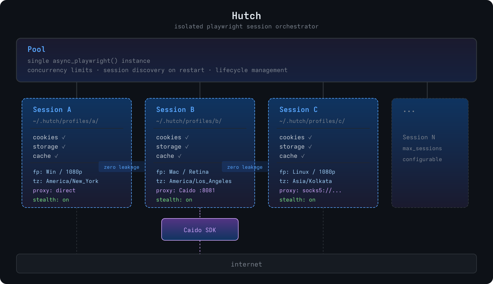

persistent chromium sessions shared by humans and agents.

every session is a real browser on its own profile. you browse it, an agent attaches to it,
either of you can move it on or off screen, and closing the window frees everything while
logins stay on disk. per-session proxy, optional personas, daemon + MCP for agents.

### Architecture



### Install

```bash
curl -fsSL hutch.abu.rocks | sh
```

installs into `~/.hutch/venv`, links `hutch` and `hutch-mcp` into `~/.local/bin`, fetches
chromium, asks for sudo only if chromium's system libraries are missing, then runs
`hutch doctor`. re-run to update; `HUTCH_REF=<tag or commit>` pins a version. uninstall with
`rm -rf ~/.hutch/venv ~/.local/bin/hutch ~/.local/bin/hutch-mcp` (profiles in
`~/.hutch/profiles` are kept).

from a checkout, for development:

```bash
git clone https://github.com/AbuCTF/Hutch.git && cd Hutch
./setup.sh
```

### Quick start

#### Browser

```bash
hutch login google                     # plain window, sign in to your Google accounts, close it
hutch clone google bb-acme             # new profile that already has those accounts
hutch browse bb-acme https://acme.com --caido   # persistent window through Caido
hutch tabs bb-acme                     # what is open
hutch headless bb-acme                 # off screen, tabs + session restored (~1.5s)
hutch headed bb-acme                   # back on screen
hutch ps                               # running browsers and their memory
hutch stop bb-acme                     # or just close the window
hutch doctor                           # libraries, fonts, display, attachable browsers
```

- closing the window ends the process; nothing keeps running and the profile stays in `~/.hutch/profiles/<name>`
- `browse` again restores the last tabs, including session cookies and sessionStorage
- agents (MCP, daemon, python) join a running session over CDP and work in their own tab
- `--browser chrome|brave|edge|/path` per profile; a profile stays on the browser it was made with
- `HUTCH_BASE_DIR` switches the profile root

#### Google sign-in

Google refuses sign-in from browsers it considers automated. `hutch login` opens the profile
with no debugging port and no automation switches — a normal browser — so sign in there once.
Later `browse` sessions (and agents) reuse the cookies, and "Sign in with Google" lists those
accounts. Accounts in another browser (Brave, Chrome) cannot be copied in: their cookies are
encrypted to that install and Google binds sessions to it. Either sign in once in a hutch
profile and `clone` it, or let agents use that browser directly with `hutch attach`.

#### Attach to your own browser

```bash
# in Chrome/Brave/Edge 144+: open <browser>://inspect/#remote-debugging and enable it
hutch attach brave --name mybrave      # agents can now use the session 'mybrave'
hutch tabs brave
```

Under WSL the Windows browser listens on Windows' 127.0.0.1, which WSL only reaches with
`networkingMode=mirrored` in `%USERPROFILE%\.wslconfig`. Browsers started inside WSL need nothing.

#### CLI

```bash
hutch create target-a --preset win-desktop-1080p    # persona: fake but coherent fingerprint
hutch create target-a --proxy http://127.0.0.1:8081 --ignore-https-errors
hutch list
hutch screenshot target-a evidence.png --full-page
hutch destroy target-a
hutch presets

# start the daemon
hutch serve
hutch serve --idle-timeout 0
hutch serve --exit-when-idle
```

#### Direct Client

```python
from hutch import Pool, generate, generate_for_program

async with Pool() as pool:
    s = await pool.create(
        "target-a",
        fingerprint=generate(preset="win-desktop-1080p"),
        proxy="http://127.0.0.1:8081",
        ignore_https_errors=True,
    )

    # action methods with smart waits
    await s.goto("https://target.com")
    await s.fill("#username", "user@test.com")
    await s.fill("#password", "pass")
    await s.click("#login-btn")  # waits for networkidle

    # observe all interactive elements
    elements = await s.observe()
    for el in elements:
        print(f"[{el['idx']}] {el['tag']} — {el['text']} → {el['selector']}")

    # page state (url + title + a11y tree) after every action
    state = await s.page_state()

    # context capture — network, console, errors
    snap = await s.snapshot(screenshot=True, storage=True)
    diff = await s.diff()  # only what changed since last check

    # cookie manipulation
    cookies = await s.cookies()
    await s.set_cookie(name="session", value="abc", domain=".target.com", path="/")
    await s.delete_cookies()

    # localStorage / sessionStorage
    await s.set_storage("token", "eyJ...")
    store = await s.storage()

    # request interception
    async def swap_auth(route):
        headers = {**route.request.headers, "Authorization": "Bearer other-user"}
        await route.continue_(headers=headers)
    await s.intercept("**/api/*", swap_auth)

    await s.save_state()
    await s.close()

    # reopen later — full auth state restored
    s = await pool.get("target-a", launch=True)
```

#### Daemon Client

```python
from hutch import HutchClient

async with HutchClient() as client:
    s = await client.create("target-a", preset="win-desktop-1080p")

    await s.goto("https://target.com/login")
    await s.fill("#user", "admin")
    await s.fill("#pass", "test")
    state = await s.click("#submit")

    elements = await s.observe()
    snap = await s.snapshot(screenshot=True)
    network = await s.network(pattern="/api/")

    # request modification
    await s.modify_headers({"X-Forwarded-For": "127.0.0.1"}, pattern="**/api/*")
    await s.block_urls(["**/analytics*", "**/tracking*"])

    # human-in-the-loop handoff
    info = await s.handoff()
    if info["state"] == "paused":
        await s.headed()      # same profile on screen, tabs restored
        # solve the captcha...
        await s.headless()
        await s.resume()

    # snapshot refs work as selectors everywhere
    print(await s.aria_snapshot())   # - button "Log in" [ref=e6]
    await s.click("e6")

    # join a browser you are using yourself
    mine = await client.attach("mybrave", "brave")
```

### Features

| Feature | Description |
|---------|-------------|
| **Real browser** | Hutch launches chromium itself; no `webdriver` flag, no HeadlessChrome UA, nothing spoofed unless asked |
| **Shared sessions** | CLI, daemon, MCP and the human's window drive the same browser over CDP |
| **Headed ↔ headless** | Relaunch on the same profile with tabs, session cookies and sessionStorage restored |
| **Attach** | Join your own Chrome/Brave/Edge (144+ remote-debugging toggle) |
| **Session isolation** | Separate profile dirs, cookies, storage, proxy per session |
| **Personas** | Optional coherent fingerprints, version-matched to the real engine |
| **Persistent state** | Cookies/storage/tabs survive close+relaunch |
| **Context capture** | Network, console, errors, navigations in ring buffers |
| **Cursor-based diffs** | Only get what changed since last check |
| **Snapshot refs** | Accessibility tree with `[ref=e12]`; refs are valid selectors in every action |
| **Page state** | URL + title + ref snapshot returned after every action |
| **Smart waits** | Click waits for networkidle; configurable strategies |
| **Request interception** | Modify headers, block URLs, swap auth tokens |
| **Cookie/storage API** | Get/set/delete cookies and localStorage |
| **Health monitoring** | Auto-detect captcha, auth expiry, rate limiting |
| **HITL handoff** | Auto-pause on challenges, human solves, agent resumes |
| **Parallel execution** | Same action across multiple sessions simultaneously |
| **Compare** | Diff responses across sessions for authz testing |
| **Daemon mode** | Unix socket JSON-RPC server for agent integration |
| **Artifacts** | HAR exports, screenshots, snapshots, agent notes |
| **Stealth** | WebDriver flag, WebGL, canvas, plugins, WebRTC |

### Fingerprint presets (personas)

Only applied when asked for (`--preset`, `--program`). Without one, sessions use the browser's
real identity — spoofing a Windows UA on a Linux engine is easier to detect than not spoofing.


| Preset | Viewport | Platform |
|--------|----------|----------|
| `win-desktop-1080p` | 1920x1080 | Win32 |
| `win-desktop-1440p` | 2560x1440 | Win32 |
| `mac-desktop-retina` | 1440x900 | MacIntel |
| `linux-desktop` | 1920x1080 | Linux x86_64 |
| `win-laptop-768p` | 1366x768 | Win32 |

each preset bundles a matching UA, platform, screen, locale, and timezone.

### Stealth

for personas, with `playwright-stealth` installed:
- `navigator.webdriver` → false
- WebGL / canvas noise
- plugin array spoofing
- font list shimming
- WebRTC IP leak blocked

not covered (chromium limitation): TLS fingerprint (JA3/JA4), HTTP/2 settings fingerprint.

### License

`MIT`
